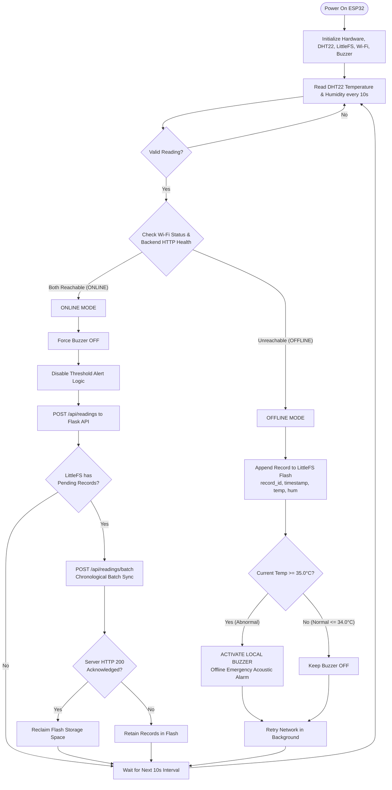

# Reliable IoT Data Transmission During Network Failure
### ESP32 Fault-Tolerant Edge Node & Reconnection Recovery Architecture

[](https://www.espressif.com/)
[](https://github.com/lorol/LITTLEFS)
[](https://flask.palletsprojects.com/)
[](https://www.chartjs.org/)

---

## 1. Project Overview

### Problem Statement
Standard IoT sensor nodes rely on continuous cloud connectivity. When network connectivity drops, standard implementations drop or fail to transmit sensor readings, causing critical telemetry blackout periods and lost audit data.

### Solution
This project implements a complete, hardware-validated edge IoT system using an **ESP32 DevKit V1** and **DHT22** sensor that:
1. Streams live sensor telemetry to a Python Flask/SQLite server every 10 seconds during normal network availability.
2. Continues uninterrupted sensor sampling during Wi-Fi or server outages, logging readings securely into the ESP32's internal non-volatile flash memory using **LittleFS** (no external SD card required).
3. Executes a local **emergency acoustic alert (active buzzer)** strictly when an abnormal temperature (> 35.0°C) is detected **during network failure**.
4. Automatically detects network restoration, immediately silences the emergency alert, and synchronizes all accumulated offline records chronologically with zero data loss, guaranteed idempotency, and preserved hardware timestamps.

---

## 2. Complete System Architecture & Operational Flow



---

## 3. Project File Structure

```text
Reliable-IoT-Data-Transmission/
│
├── esp32_firmware/
│   └── reliable_iot.ino          # Complete, non-blocking ESP32 Arduino C++ firmware
│
├── backend/
│   ├── app.py                    # Flask REST API endpoints and static web server
│   ├── database.py               # SQLite schema, transaction handling, deduplication
│   ├── requirements.txt          # Python dependencies (flask, flask-cors)
│   └── test_api.py               # Automated integration verification suite
│
├── frontend/
│   ├── index.html                # Responsive cyberpunk dark-blue dashboard
│   ├── style.css                 # Theme styles, neon glow cards, visual buzzer waves
│   └── script.js                 # Chart.js telemetry lines, polling, CSV export
│
├── database/
│   └── sensor_data.db            # SQLite database file (auto-generated)
│
├── docs/
│   ├── circuit_connections.md    # Pinouts, transistor buzzer driver, safety rules
│   └── testing_guide.md          # 11-Phase plan, hackathon demo scripts, checklist
│
└── README.md                     # Comprehensive project documentation
```

---

## 4. Hardware Wiring Summary

| Component | Pin | Connected to ESP32 Pin | Notes |
|---|---|:---:|---|
| **DHT22 Sensor** | VCC | **3V3** | Use 3.3V to ensure safe logic levels |
| | DATA | **GPIO 4** | 10k pull-up to 3.3V if bare 4-pin AM2302 |
| | GND | **GND** | Common ground reference |
| **Active Buzzer** | (+) Terminal | **VIN (5V) or 3V3** | Powered from rail |
| | (-) Terminal | **Transistor Collector** | Driven via NPN transistor |
| **NPN (2N2222 / BC547)** | Base (B) | **GPIO 18** | via 1 kΩ base resistor |
| | Emitter (E) | **GND** | Common ground |

---

## 5. Timestamp Strategy & Reliability Analysis

1. **Initial Time Acquisition:**
   Upon Wi-Fi connection, the ESP32 synchronizes its hardware Real-Time Clock (RTC) using SNTP via `pool.ntp.org` and `time.nist.gov`.
2. **Offline Continuity:**
   When the network disconnects, the ESP32's internal RTC hardware timer continues running accurately via its internal oscillator with less than 1 second of drift per hour.
3. **Offline Boot Handling:**
   If the ESP32 restarts during a network failure, the firmware detects the uninitialized epoch and calculates synthetic reference timestamps anchored to the boot session counter and monotonic `millis()` counter, preserving sequential integrity.
4. **Unique Record ID Architecture:**
   Every measurement generates a globally unique ID: `ESP32_[MAC_SUFFIX]_[BOOT_SESSION]_[SEQUENCE]`. For example: `ESP32_E465B8_S2_00045`.
5. **Flash Wear & Storage Capacity:**
   - LittleFS provides active wear-leveling across ESP32 SPI flash blocks.
   - Allocated LittleFS partition size: **1.4 MB**.
   - Average record size: **~80 bytes**.
   - Maximum storage capacity: $\frac{1,400,000 \text{ bytes}}{80 \text{ bytes}} \approx \mathbf{17,500 \text{ readings}}$.
   - Continuous offline duration: $17,500 \times 10 \text{ seconds} = 175,000 \text{ s} \approx \mathbf{48.6 \text{ hours}}$ of continuous blackout logging!

---

## 6. Quick Start Guide

### Step 1: Start the Backend & Dashboard
```powershell
cd Reliable-IoT-Data-Transmission/backend
python -m pip install -r requirements.txt
python app.py
```
Open **`http://localhost:5000`** in your browser.

### Step 2: Upload Firmware to ESP32
1. Open `esp32_firmware/reliable_iot.ino` in Arduino IDE.
2. In lines 40–46, set your local Wi-Fi SSID, password, and your computer's local IP address (e.g. `172.16.204.209`).
3. Select Board: **DOIT ESP32 DEVKIT V1**.
4. Click **Upload** and open Serial Monitor at **115200 baud**.

### Step 3: Run Automated Verification Tests
```powershell
python Reliable-IoT-Data-Transmission/backend/test_api.py
```
Outputs 8 comprehensive integration verification tests covering live streaming, deduplication, batch syncing, and database consistency.
